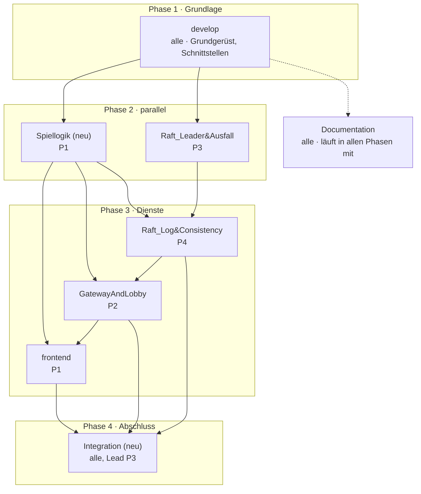

# Queens – Branch-Plan

Stand: 26.10.2026

Die Umsetzung läuft über die vorhandenen Branches; zwei kommen dazu: `feature/Spiellogik` und `feature/Integration`. Jede Person verantwortet feste Komponenten (P1–P4). Gearbeitet wird gegen `develop`, `main` bekommt nur geprüfte Stände.

## Überblick

P1 verantwortet Spiellogik und Frontend, P2 GatewayAndLobby samt Datenbank, P3 die Raft-Leader-Wahl und die Integration, P4 Raft-Log und Ergebnisse; an Documentation schreiben alle. P2 trägt am meisten; wird es zu viel, kann P1 den Gateway-Teil übernehmen, weil er eng am Frontend hängt.

| Branch | Status | Verantwortlich | Inhalt |
| --- | --- | --- | --- |
| `main` | vorhanden | alle | nur geprüfte Stände (Vorstellung, Abgabe) |
| `develop` | vorhanden | alle | Integrationszweig; Grundgerüst als erster Commit |
| `feature/Spiellogik` | **neu** | P1 | Kartenspiel als deterministische Zustandsmaschine |
| `feature/Raft_Leader&Ausfall` | vorhanden | P3 | Rollen, Terms, Leader-Wahl, Heartbeats, Check-Quorum |
| `feature/Raft_Log&Consistency` | vorhanden | P4 | Log, Commit, Zustandsmaschine, Cluster-Client, Ergebnisse speichern |
| `feature/GatewayAndLobby` | vorhanden | P2 | Datenbank, Lobby-Cluster, Gateway |
| `feature/frontend` | vorhanden | P1 | Terminal-Client, optional Browser-Client |
| `feature/Integration` | **neu** | alle, Lead P3 | Startskript, Ausfall-Demo, Ende-zu-Ende-Test |
| `feature/Documentation` | vorhanden | alle | README, Diagramme, Testprotokoll, Ausarbeitung, Präsentation |

## Arbeitsweise

Feature-Branches gehen per Pull Request nach `develop`, den mindestens eine andere Person prüft. `develop` wird nur an Meilensteinen nach `main` gemergt, etwa vor der Vorstellung und vor der Abgabe. Die Git-Historie wird mit abgegeben und zeigt damit auch, wer was gebaut hat.

- **Neue Branches von `develop` aus anlegen:** `git switch develop`, dann `git switch -c feature/Spiellogik` und ebenso `feature/Integration`.
- **`&` im Branch-Namen:** In der Shell muss der Name in Anführungszeichen stehen, sonst startet `&` einen Hintergrundprozess: `git switch "feature/Raft_Leader&Ausfall"`.
- **`develop` bleibt lauffähig:** Merge nur, wenn `python -m pytest` grün ist und der Branch eigene Tests mitbringt.
- **Teile einzeln mergen:** GatewayAndLobby, Raft\_Log&Consistency, frontend und Integration haben mehrere Teile. Jeder Teil geht als eigener Pull Request nach `develop`, sobald er fertig ist; der Branch läuft danach weiter.
- **Schnittstellen zuerst:** Die Verträge aus dem Grundgerüst (Aktionsformat, WebSocket-Protokoll, HTTP-Endpunkte) ändert niemand allein. Änderungen kommen als eigener kleiner PR, den alle Betroffenen abnicken.
- **Auf Stand bleiben:** lange laufende Branches regelmäßig mit `develop` abgleichen; kleine Commits mit klarer Nachricht, z. B. `raft: Election-Timeout randomisieren`.
- **Parallel arbeiten mit Stubs:** Wer auf einen noch nicht gemergten Teil wartet, programmiert gegen den Stub aus dem Grundgerüst und tauscht ihn beim Merge aus.
- **Notizen für die Ausarbeitung:** Entscheidungen und Schwierigkeiten laufend in `feature/Documentation` festhalten.

## Reihenfolge

Nach dem Grundgerüst auf `develop` starten Spiellogik, Raft\_Leader&Ausfall und GatewayAndLobby gleichzeitig. GatewayAndLobby beginnt mit dem Datenbank-Teil und arbeitet bis zum Merge von Raft\_Log&Consistency gegen Stubs.

Pfeil = baut auf. Neu anzulegen sind `feature/Spiellogik` und `feature/Integration`.

Integration setzt alle Dienste voraus; Documentation läuft in allen Phasen mit. Im Diagramm fehlt das Präfix `feature/` vor den Namen.

## `develop` · Grundgerüst als erster Commit

**Verantwortlich:** alle gemeinsam · **Ziel:** direkt auf `develop`, vor allen Feature-Branches · **Dateien:** Ordnerstruktur, `requirements.txt`, `pytest.ini`, `services/netconfig.py`, `docs/schnittstellen.md`, Stubs

Der erste Stand auf develop legt fest, wie die Komponenten miteinander reden, damit danach alle parallel arbeiten können. Am besten in einer gemeinsamen Sitzung von 1–2 Stunden erledigen und direkt auf develop committen; erst danach zweigen die Feature-Branches ab.

### Umzusetzen

1. **Projektstruktur:** `queens_engine/`, `services/raft/`, `services/lobby/`, `services/gateway/`, `client/`, `tests/`, `docs/`, je mit `__init__.py`. Dazu `.gitignore` (`logs/`, `__pycache__/`, `.venv/`), `requirements.txt` (fastapi, uvicorn, httpx, websockets, asyncpg, pytest) und `pytest.ini` mit `pythonpath = .`.
2. **`services/netconfig.py`:** `parse_nodes("1=http://…,2=…")`, `parse_clusters("a=url|url;b=…")` und `setup_logging(name)` mit einheitlichem Logformat für alle Dienste.
3. **`docs/schnittstellen.md`** – die Verträge, gegen die alle programmieren:
   - **Aktionsformat** (JSON): `{"type", "player_id", "action_id", …}` mit allen 12 Aktionstypen und ihren Feldern (`StartGame`, `PeekInitial`, `DrawFromDeck`, `TakeFromDiscard`, `SwapWithHand`, `DiscardDrawn`, `UseJack`, `UseKing`, `SkipSpecial`, `Knock`, `ThrowIn`, `TurnTimeout`).
   - **Ereignisformat:** `{"type", "data", "audience"}`; `audience = null` heißt an alle, sonst nur an diesen Spieler.
   - **Spielersicht:** Felder von `player_view` (Phase, aktiver Spieler, Stapelgrößen, oberste Ablagekarte, Slot-Belegung ohne Kartenwerte, `version`, Ergebnis am Ende).
   - **WebSocket-Protokoll** (Feld `op`): Client → Gateway `hello`, `create_lobby`, `join_lobby`, `leave_lobby`, `ready`, `action`; Gateway → Client `welcome`, `lobby`, `game_started`, `events`, `state`, `info`, `error`.
   - **Lobby-REST:** `POST /lobbies`, `GET /lobbies/{id}`, `POST /lobbies/{id}/join|leave|ready`, `GET /health`, jeweils mit Antwortformat.
   - **Game-Service-HTTP:** `POST /raft/request_vote`, `POST /raft/append_entries`, `POST /client/submit` (Antwort `ok` + Ereignisse + Sichten, oder `error` = `rule` | `not_leader` + Leader-Adresse | `timeout`), `GET /client/views/{game}`, `GET /status`, `POST /admin/isolate`.
   - **Raft-Befehle** im Log: `NoOp`, `CreateGame`, `Action`.
   - **Ports:** Gateway 8000, Lobby-Instanz i = 8000 + i, Raft-Knoten n = 8100 + n, PostgreSQL 5432.
4. **Stubs für paralleles Arbeiten:** leere Module mit den Klassen- und Funktionssignaturen. Wichtig ist der Raft-Knoten: `node.py` (gemeinsamer Zustand, Rollen, Ticker), `election.py` (P3) und `replication.py` (P4) als getrennte Dateien, damit sich P3 und P4 nicht ständig in die Quere kommen.
5. **README-Gerüst:** Installation, Start, Tests. Wird von den späteren Branches ergänzt.

### Fertig, wenn

- [ ] `python -m pytest` läuft (auch ohne Tests) und alle Module lassen sich importieren
- [ ] `docs/schnittstellen.md` ist von allen vier gelesen und abgenickt
- [ ] Jede Person weiß, gegen welchen Stub sie bis zum Merge der anderen programmiert

## `feature/Spiellogik` (neu)

**Verantwortlich:** P1 · **Baut auf:** Grundgerüst auf `develop` · **Dateien:** `queens_engine/` (`config`, `models`, `actions`, `events`, `rules`, `engine`, `scoring`, `views`), `hotseat.py`, `tests/test_engine.py`

Die Spielregeln als reine Python-Bibliothek: `apply(state, action)` liefert neuen Zustand und Ereignisse, ohne Netzwerk, Uhrzeit oder freien Zufall. Nur so erreichen alle Raft-Knoten denselben Zustand.

### Umzusetzen

1. **`config.py`:** `RulesConfig` mit 2–8 Spielern, 4 Handkarten, 2 Startkarten zum Ansehen, Schalter für „Karten des Klopfenden gesperrt“ und „Strafkarte bei falschem Zwischenwerfen“.
2. **`models.py`:**
   - `Card` mit Wert: Dame −1, Ass 1, Zahlenkarten nach Augenwert, Bube und König 10. 52er-Blatt in fester Reihenfolge.
   - `CardRef(player_id, slot)` für Bube und König.
   - `Phase`: `lobby`, `initial_peek`, `await_draw`, `await_decision`, `await_special`, `finished`.
   - `PlayerState` mit **festen Slots** (`None` nach Zwischenwerfen), damit „Spieler B, Slot 3“ stabil bleibt.
   - `GameState` mit Stapeln, aktivem Spieler, Zugnummer, gezogener Karte, offener Sonderaktion, Klopfer, Punkten, Gewinnern, verarbeiteten `action_id`s und `version`. `create_game()` prüft Spieleranzahl und eindeutige IDs.
3. **`actions.py`:** die 12 Aktionen als unveränderliche Dataclasses mit `player_id` und `action_id`; `action_to_dict` / `action_from_dict` für Netzwerk und Raft-Log.
4. **`events.py`:** `Event(type, data, audience)` mit Hilfen `public()` und `private()`.
5. **`rules.py` – `validate()`** prüft je Aktion Phase und Berechtigung:
   - Ziehen, Tauschen, Ablegen, Sonderaktion und Klopfen nur für den aktiven Spieler.
   - Klopfen nur vor dem Ziehen und nur einmal pro Partie.
   - Zwischenwerfen für jeden Spieler in jeder Zugphase, außer dem Klopfenden.
   - `TurnTimeout` nur vom System und nur mit der aktuellen Zugnummer.
6. **`engine.py` – `apply()`:**
   - Doppelte `action_id` wird ignoriert; der übergebene Zustand wird nie verändert (Kopie).
   - Mischen mit `random.Random(f"{seed}:{reshuffle_count}")`; Seed kommt aus `StartGame`.
   - Austeilen: 4 Karten je Spieler, eine Karte offen auf die Ablage; alle sehen sich 2 Karten an, dann beginnt Zug 1.
   - Ziehen vom Stapel (leer → Ablage außer oberster Karte neu mischen) oder von der Ablage; dann tauschen oder ablegen.
   - Wird ein Bube oder König abgelegt (auch nach Aufnahme von der Ablage): Sonderaktion oder überspringen. Bube tauscht zwei beliebige Karten blind, König zeigt eine Karte nur dem aktiven Spieler.
   - Zwischenwerfen: gleicher Rang → Slot wird leer; falscher Rang → Karte bleibt, Strafkarte in neuem Slot.
   - Klopfen beendet den Zug; ist der Klopfende wieder dran, wird ausgewertet.
   - Timeout: in der Startphase verzichten Nachzügler aufs Ansehen; im Zug wird eine gezogene Karte abgelegt und der Zug beendet.
7. **`scoring.py`:** Summe je Hand, niedrigste gewinnt, bei Gleichstand mehrere Gewinner.
8. **`views.py` – `player_view()`:** keine Kartenwerte (gespielt wird „wie am echten Tisch“), gezogene Karte nur für den aktiven Spieler, `version`, am Ende alle Karten und Punkte.
9. **`hotseat.py`:** alle Spieler an einem Terminal, zum Testen ohne Netzwerk.

### Fertig, wenn

- [ ] Gleicher Seed ergibt gleichen Zustand; Startkarten sind privat
- [ ] Nur der aktive Spieler darf ziehen; Tauschen legt die alte Karte ab
- [ ] Bube tauscht zwischen Spielern, auch nach Aufnahme von der Ablage; König zeigt nur dem Aktiven
- [ ] Zwischenwerfen außerhalb des Zugs klappt; falsches Werfen gibt eine Strafkarte
- [ ] Klopfen beendet die Partie mit korrekten Punkten; Karten des Klopfenden sind gesperrt
- [ ] Doppelte Aktion wird ignoriert; veralteter Timeout wird abgelehnt; Neumischen klappt
- [ ] Sicht verrät keine Kartenwerte; Serialisierung hin und zurück ist verlustfrei
- [ ] Zufällige Partie mit 8 Spielern endet, und es gehen keine der 52 Karten verloren

**Hinweis:** Kein `time`, kein `random` ohne Seed, kein I/O in `queens_engine/`. Sonst laufen die Raft-Replikate auseinander, und genau das ist in der Vorstellung schwer zu erklären.

## `feature/Raft_Leader&Ausfall`

**Verantwortlich:** P3 · **Baut auf:** Grundgerüst auf `develop` · **Dateien:** `services/raft/node.py` (Kern), `election.py`, `transport.py`, `storage.py`, `server.py` (Raft-Endpunkte, Status, Isolation), Wahl-Tests in `tests/test_raft.py`

Der Cluster wählt selbstständig genau einen Leader und wählt bei dessen Ausfall nach 1,5–3 s einen neuen. Die Clustergröße ist frei wählbar: n Knoten tolerieren (n−1)/2 Ausfälle.

### Umzusetzen

1. **Kernzustand** (`node.py`): `node_id`, Adressen aller Knoten, `current_term`, `voted_for`, Rolle (`follower`, `candidate`, `leader`), `leader_id`, Mehrheit = n // 2 + 1.
2. **Ticker** (alle 20 ms): Follower und Candidate starten bei abgelaufener Frist eine Wahl; ein Leader prüft das Quorum.
3. **Randomisierter Election-Timeout** (Standard 1,5–3 s, per Parameter einstellbar). Neu gesetzt bei gültigem AppendEntries und bei abgegebener Stimme. Die Zufallsspanne verhindert, dass alle gleichzeitig kandidieren.
4. **Wahl** (`election.py`): Term + 1, für sich selbst stimmen, `RequestVote` parallel an alle anderen (`asyncio.as_completed`). Mehrheit → Leader; Antwort mit höherem Term → zurück zum Follower. Ein Ein-Knoten-Cluster wird sofort Leader.
5. **`handle_request_vote`:** höherer Term → Term übernehmen und Follower werden. Stimme nur, wenn im aktuellen Term noch nicht anders gestimmt wurde **und** das Log des Kandidaten mindestens so aktuell ist (letzter Term, dann letzter Index). Dafür braucht es `last_index` und `term_at()` aus der Replikation; die Signaturen stehen im Grundgerüst.
6. **`step_down(term)`:** Term und Stimme aktualisieren, speichern, Rolle Follower. Ruft einen Hook von P4 auf, der offene Client-Anfragen mit „nicht mehr Leader“ beendet.
7. **`become_leader()`:** Rolle und `leader_id` setzen, dann den Hook `on_become_leader()` von P4 aufrufen (No-Op-Eintrag, Replikatoren starten).
8. **Check-Quorum:** Hat ein Leader länger als den maximalen Election-Timeout keine Antwort von einer Mehrheit, tritt er zurück. Damit hält sich ein abgetrennter Leader nicht weiter für zuständig (kein Split-Brain). Die Zeitstempel der Antworten liefert der Replikator von P4.
9. **Transport** (`transport.py`): abstraktes `call(peer, rpc, payload)` → Antwort oder `None`. `HttpTransport` mit httpx und 1 s Timeout plus Schalter `isolated` für die Demo; `InMemoryNetwork` mit `isolate()` / `heal()` für schnelle Tests ohne HTTP.
10. **Server** (`server.py`): `POST /raft/request_vote`, `POST /raft/append_entries` (gibt an P4 weiter), `GET /status` (Rolle, Term, Leader, Log-Länge, Commit-Index), `POST /admin/isolate` (isoliert → Raft-Endpunkte antworten 503). Parameter `--id`, `--nodes`, `--election-min`, `--election-max`, `--heartbeat`, `--rpc-timeout`.
11. **Optional `storage.py`:** Term, Stimme und Log als JSON sichern (`--data-dir`), atomar per Umbenennen. Ohne das kann ein neu gestarteter Knoten theoretisch zweimal im selben Term abstimmen; das gehört in die Reflexion.

### Fertig, wenn

- [ ] Genau ein Leader wird gewählt und bleibt stabil, solange keiner ausfällt
- [ ] Nach Absturz des Leaders gibt es in höherem Term einen neuen
- [ ] Ein isolierter Leader tritt nach etwa 3 s zurück, die Mehrheit wählt neu
- [ ] 5 Knoten verkraften 2 Ausfälle; bei 3 Ausfällen wird kein Leader mehr bestätigt

**Hinweis:** Die Grenze zu P4 ist eng. Legt zu Beginn gemeinsam fest, welche Methoden der andere aufruft (`last_index`, `term_at`, `on_become_leader`, `fail_pending`, Antwortzeitpunkte für Check-Quorum), und testet den Wahlteil zunächst mit leerem Log.

## `feature/Raft_Log&Consistency` · Teil 1: Replikation

**Verantwortlich:** P4 · **Baut auf:** `feature/Spiellogik`, `feature/Raft_Leader&Ausfall` · **Dateien:** `services/raft/replication.py`, `state_machine.py`, `client.py`, `server.py` (Client-Endpunkte), Replikations-Tests in `tests/test_raft.py`

Jede Spielaktion landet im Log des Leaders, wird an die Follower verteilt und gilt erst als angenommen, wenn eine Mehrheit sie gespeichert hat. Alle Knoten wenden bestätigte Einträge in derselben Reihenfolge auf die Spiellogik an.

### Umzusetzen

1. **Log:** Liste aus `{"term", "command"}`, Indizes ab 1 (Index 0 = leer, Term 0). Methoden `last_index` und `term_at(i)` für P3.
2. **`on_become_leader()`:** `next_index` je Follower auf Log-Ende + 1, `match_index` auf 0, einen `NoOp`-Eintrag im neuen Term anhängen, je Follower einen Replikator-Task starten.
3. **Replikator** (je Follower): `AppendEntries` mit vorherigem Index und Term, bis zu 200 Einträgen und dem Commit-Index. Erfolg → `match_index` / `next_index` hochsetzen, Commit prüfen. Ablehnung → mit dem Hinweis des Followers zurückspringen und erneut senden. Neue Einträge wecken den Task sofort, sonst geht alle 0,3 s ein leerer Heartbeat raus. Antwortzeitpunkte an P3 für Check-Quorum melden.
4. **`handle_append_entries`:** kleinerer Term → ablehnen. Sonst Follower werden, `leader_id` merken, Konsistenz des vorherigen Eintrags prüfen, bei Widerspruch den abweichenden Rest abschneiden, neue Einträge anhängen, Commit-Index übernehmen und anwenden.
5. **Commit-Regel:** höchster Index N, den eine Mehrheit gespeichert hat **und** dessen Term der aktuelle ist. Ältere Einträge werden nur indirekt mit committet (Abbildung 8 im Raft-Paper).
6. **Anwenden:** bestätigte Einträge der Reihe nach an die Zustandsmaschine geben und wartende Anfragen mit dem Ergebnis auflösen. Eine Ausnahme beim Anwenden darf den Knoten nie anhalten.
7. **`submit(command)`** (nur Leader, nacheinander per Lock):
   - Warten, bis der No-Op des Terms angewendet ist; erst dann ist der Zustand aktuell.
   - Vorabprüfung durch die Zustandsmaschine: Ungültige Aktionen kommen gar nicht ins Log.
   - Anhängen, Replikatoren wecken, bis 5 s auf das Ergebnis warten. Sonst `CommitTimeout`; als Follower `NotLeader` mit Leader-Adresse.
8. **`state_machine.py` – `GameStateMachine`:** `precheck()` (Spielanlage gültig, Aktion regelkonform, Duplikate durchlassen) und `apply()` für `NoOp`, `CreateGame` (idempotent je `game_id`) und `Action` (ruft `queens_engine.apply`, liefert Ereignisse und die Sichten aller Spieler).
9. **`client.py` – `ClusterClient`** für Lobby und Gateway: merkt sich den Leader, folgt dem `not_leader`-Hinweis, probiert bei Verbindungsfehlern den nächsten Knoten und gibt nach 15 s mit `ClusterUnavailable` auf. Wiederholen ist sicher, weil jede Aktion ihre feste `action_id` behält.
10. **Server:** `POST /client/submit` und `GET /client/views/{game_id}` mit den Antworten aus dem Schnittstellen-Dokument.

### Fertig, wenn

- [ ] Befehle stehen auf allen Knoten identisch im Log, alle Spielzustände sind gleich
- [ ] Eine ungültige Aktion wird abgelehnt und verlängert das Log nicht
- [ ] Nach Absturz des Leaders ist nichts verloren, und die Partie läuft weiter
- [ ] Ein isolierter Leader kann nichts bestätigen und holt nach der Rückkehr auf
- [ ] Ein leer neu gestarteter Knoten holt das komplette Log nach
- [ ] Eine doppelt eingereichte Aktion wird genau einmal angewendet

**Hinweis:** Bis dieser Branch gemergt ist, testet P2 Lobby und Gateway gegen einen Stub-`ClusterClient`. Danach reicht zum Entwickeln auch ein Ein-Knoten-Cluster (`--nodes 1`).

## `feature/Raft_Log&Consistency` · Teil 2: Ergebnisse speichern

**Verantwortlich:** P4 · **Baut auf:** Teil 1, Datenbank-Teil aus `feature/GatewayAndLobby` · **Dateien:** `services/raft/results.py`, `server.py` (Parameter `--db`)

Nach Spielende speichert der aktuelle Raft-Leader die Partie mit Spielernamen und Punkten in PostgreSQL, und zwar genau einmal, auch wenn der Leader dabei wechselt.

### Umzusetzen

1. **`ResultWriter`** als Hintergrund-Task in jedem Game-Service. Er prüft jede Sekunde, ist aber nur aktiv, solange der Knoten Leader ist.
2. **Suchen:** alle Partien im replizierten Zustand mit Phase `finished`, die dieser Knoten noch nicht gespeichert hat.
3. **Speichern** über `ResultRepository.save()`: je Spieler `player_id`, Name, Punkte, Gewinner; dazu der Name des Klopfenden.
4. **Datenbank nicht erreichbar:** Warnung ins Log und in der nächsten Runde erneut versuchen. Die laufenden Partien sind davon nicht betroffen.
5. **Leader-Wechsel:** Der neue Leader kennt die gespeicherten Partien nicht und schreibt sie im Zweifel erneut. Die Datenbank verwirft Doppelte, weil `game_id` Primärschlüssel ist.
6. **`--db` ist optional:** Ohne Angabe läuft der Game-Service wie bisher, nur ohne Persistenz. Das hält die Raft-Tests unabhängig von PostgreSQL.

### Fertig, wenn

- [ ] Nach einer Partie stehen `games` und `game_results` mit den richtigen Namen und Punkten in der Datenbank
- [ ] Wird der Leader direkt nach Spielende beendet, steht die Partie trotzdem genau einmal da
- [ ] Ist PostgreSQL kurz weg, wird das Ergebnis nachgeholt, sobald sie wieder läuft

## `feature/GatewayAndLobby` · Teil 1: Datenbank

**Verantwortlich:** P2 · **Baut auf:** Grundgerüst auf `develop` · **Dateien:** `services/schema.sql`, `services/db.py`, `tests/test_db.py`

Eine zentrale PostgreSQL-Instanz hält Lobbys, Spielernamen und Spielergebnisse. Weil mehrere Lobby-Instanzen gleichzeitig zugreifen, läuft jede Änderung als Transaktion mit Zeilensperre.

### Umzusetzen

1. **Schema** (`schema.sql`, idempotent mit `IF NOT EXISTS`):
   - `lobbies`: `lobby_id` (Schlüssel), `host_id`, `status` (`waiting` | `starting` | `started` | `finished`), `game_id` (eindeutig), `cluster`, Zeitstempel.
   - `lobby_players`: Lobby, `player_id`, `name`, `ready`, Beitrittszeit; löschen kaskadiert mit der Lobby.
   - `games`: `game_id` (Schlüssel), Lobby, Name des Klopfenden, Endzeit.
   - `game_results`: Partie, Spieler, Spielername, Punkte, Gewinner ja/nein.
   - Sequenz `cluster_rr` für die reihum-Verteilung auf Cluster.
2. **`Database`:** asyncpg-Pool (1–5 Verbindungen), Verbindung aus `--db` oder `QUEENS_DB`. Verbindet bei Bedarf neu, auch nach einem Datenbankausfall. Legt beim Start das Schema unter einem Advisory-Lock an, weil n Instanzen gleichzeitig starten. Dazu `ping()` für den Health-Check.
3. **`LobbyRepository`** (jede Methode eine Transaktion, Lobby-Zeile mit `SELECT … FOR UPDATE` gesperrt):
   - `create`: zufälliger 4-stelliger Code ohne verwechselbare Zeichen (0/O, 1/I); bei Kollision neu würfeln.
   - `join`: nur im Status `waiting`, höchstens 8 Spieler, erneuter Beitritt ist harmlos.
   - `leave`: leere Lobby löschen; verlässt der Host die Lobby, übernimmt der nächste.
   - `set_ready`: Sind danach alle bereit (mindestens 2), wechselt die Lobby auf `starting`, bekommt `game_id` und Cluster, und **nur dieser Aufruf** erhält ein `StartTicket`.
   - `claim_stale_start`: Hängt eine Lobby länger als 15 s in `starting` (Instanz abgestürzt), darf eine andere den Start übernehmen.
   - `mark_started` und `abort_start` (zurück auf `waiting`, alle müssen sich neu bereit melden).
4. **`ResultRepository`:** `save()` mit `INSERT … ON CONFLICT DO NOTHING`, setzt die Lobby auf `finished` und meldet zurück, ob neu gespeichert wurde. `recent()` für die Admin-Konsole.
5. **Fehler:** `LobbyError(status, meldung)` für fachliche Fehler (404, 403, 409) und `DatabaseUnavailable`.

### Fertig, wenn

- [ ] Anlegen, Beitreten, Verlassen und Host-Wechsel funktionieren über zwei getrennte Pools
- [ ] Gleichzeitiges Bereitmelden über zwei Instanzen ergibt genau ein Start-Ticket (20-mal wiederholt)
- [ ] 14 parallele Beitritte führen zu genau 8 Spielern
- [ ] Cluster werden reihum vergeben; ein hängender Start kann übernommen werden
- [ ] Ein Ergebnis wird auch bei doppeltem Speichern genau einmal abgelegt

**Hinweis:** Die Tests laufen gegen eine echte Testdatenbank `queens_test` und überspringen sich, wenn keine erreichbar ist. Die Einrichtung (Benutzer und Datenbank anlegen) gehört in die README. Die gleichzeitigen Zugriffe sind ein gutes Thema für die Ausarbeitung.

## `feature/GatewayAndLobby` · Teil 2: Lobby-Service

**Verantwortlich:** P2 · **Baut auf:** Teil 1, `feature/Spiellogik` (`StartGame`), `feature/Raft_Log&Consistency` (`ClusterClient`) · **Dateien:** `services/lobby/app.py`

Beliebig viele Lobby-Instanzen laufen parallel und speichern selbst nichts; jede kann jede Anfrage beantworten. Sind alle Spieler bereit, startet genau eine Instanz die Partie im Game-Service-Cluster.

### Umzusetzen

1. **FastAPI-App** mit Parametern `--id` (z. B. `l1`), `--host`, `--port`, `--db` und `--clusters "a=url|url|url;b=…"`.
2. **Zustandslos:** Keine Lobby-Daten im Speicher, alles über `LobbyRepository`. Nur die `ClusterClient`-Objekte (einer je Cluster) leben im Prozess.
3. **Endpunkte** wie im Schnittstellen-Dokument: `POST /lobbies`, `GET /lobbies/{id}`, `POST /lobbies/{id}/join`, `/leave`, `/ready` und `GET /health` (Instanz und ob die Datenbank erreichbar ist). Die Antwort enthält die Cluster-Adressen der Partie und `served_by`, damit man in der Demo sieht, welche Instanz geantwortet hat.
4. **Fehlerabbildung:** `LobbyError` auf den passenden HTTP-Status, Datenbank nicht erreichbar auf 503.
5. **Spielstart**, wenn `set_ready` ein Ticket liefert:
   - `CreateGame` mit Spielerliste an den Cluster (idempotent je `game_id`).
   - `StartGame` mit zufälligem Seed und fester `action_id` = `<game_id>-start`.
   - Dann `mark_started`. Ist der Cluster nicht erreichbar: `abort_start` und 503 mit „Bitte erneut bereit melden“.
6. **Erholung:** Fragt jemand eine Lobby ab, die länger als 15 s in `starting` hängt, übernimmt diese Instanz den Start. Das ist sicher, weil beide Schritte idempotent sind.
7. **Logging** mit Instanzname, z. B. „Partie ABCD-1a2b3c gestartet (Cluster a, 3 Spieler)“.

### Fertig, wenn

- [ ] Zwei Instanzen auf 8001 und 8002 liefern für dieselbe Lobby dieselben Daten
- [ ] Nach Beenden einer Instanz läuft alles über die andere weiter
- [ ] Gleichzeitiges Bereitmelden über beide Instanzen startet die Partie genau einmal
- [ ] Bei nicht erreichbarem Cluster kommt eine verständliche Meldung, und die Lobby bleibt nutzbar

**Hinweis:** Bis `feature/Raft_Log&Consistency` gemergt ist, reicht ein Stub-`ClusterClient`, der `CreateGame` und `StartGame` mit `ok: true` beantwortet.

## `feature/GatewayAndLobby` · Teil 3: Gateway

**Verantwortlich:** P2 · **Baut auf:** Teil 2, `feature/Raft_Log&Consistency` (`ClusterClient`) · **Dateien:** `services/gateway/app.py`

Das Gateway ist der einzige Einstiegspunkt für die Clients. Es hält die WebSocket-Verbindungen, leitet Lobby-Befehle an die Lobby-Instanzen und Spielaktionen an den Raft-Leader und schickt jedem Spieler nur, was er sehen darf. Es läuft als eine Instanz (mit dem Dozenten abgestimmt).

### Umzusetzen

1. **WebSocket `/ws`:** Erste Nachricht muss `hello` mit Name und optionaler `player_id` sein. Ohne ID vergibt das Gateway eine; Antwort `welcome` mit `player_id` und `reconnected`.
2. **Sitzungen** je Spieler: Verbindung, Lobby, Partie und ein Sende-Lock, damit sich Nachrichten nicht überschneiden.
3. **Reconnect:** Gleiche `player_id` ersetzt die alte Verbindung. Die anderen erhalten eine Info, der Spieler bekommt Lobby oder aktuelle Spielsicht neu (Sichten vom Cluster).
4. **`LobbyPool`:** Lobby-Anfragen reihum auf alle Adressen aus `--lobby url,url` verteilen. Schlägt der Verbindungsaufbau fehl, die nächste Instanz nehmen und die ausgefallene 5 s überspringen. **Nicht** wiederholen, wenn die Anfrage schon angekommen war, denn sie könnte bereits ausgeführt sein.
5. **Lobby-Ereignisse:** jede Antwort an alle Mitglieder der Lobby verteilen. Bei Status `started` die Partie einrichten (Cluster-Adressen, Spieler, Namen), `game_started` und die ersten Sichten senden.
6. **Spielaktionen:** `player_id` immer aus der Sitzung setzen (nicht fälschbar), `action_id` ergänzen, falls sie fehlt, über `ClusterClient.submit` einreichen. Abgelehnte Aktionen gehen als `error` nur an den Absender.
7. **Verteilen:** je Spieler nur die Ereignisse mit passender `audience`, dazu seine eigene Sicht und die verbleibende Zugzeit. Sichten mit kleinerer `version` als zuletzt gesendet verwerfen.
8. **Timeouts und AFK-Schutz:** 60 s für das Ansehen der Startkarten, 60 s pro Zug bei verbundenem Spieler, 15 s bei getrenntem. Bei Ablauf eine `TurnTimeout`-Aktion mit Zugnummer und fester `action_id` einreichen. Der Timer wird bei jeder neuen Sicht und bei jedem Verbindungsabbruch neu gestellt.
9. **Betrieb:** `GET /health`; Parameter `--host`, `--port`, `--lobby`, `--turn-timeout`, `--afk-timeout`, `--peek-timeout`.

### Fertig, wenn

- [ ] Zwei Clients spielen eine komplette Partie über das Gateway
- [ ] Der Ausfall einer Lobby-Instanz bleibt für die Spieler unsichtbar
- [ ] Ein Leader-Wechsel zeigt sich nur als kurze Verzögerung; die WebSocket-Verbindung bleibt
- [ ] Nach einem Reconnect hat der Spieler wieder die aktuelle Sicht
- [ ] Ein getrennter Spieler am Zug wird nach 15 s übersprungen
- [ ] Kein Client erhält fremde Kartenwerte

## `feature/frontend` · Teil 1: Terminal-Client

**Verantwortlich:** P1 · **Baut auf:** `feature/Spiellogik` (Sicht- und Ereignisformat), `feature/GatewayAndLobby` (zum echten Testen) · **Dateien:** `client/cli.py`, `client/render.py`, `netcheck.py`

Der Terminal-Client verbindet sich per WebSocket mit dem Gateway, zeigt den Tisch als Text und übersetzt Eingaben in Aktionen. Er enthält keine Spielregeln; geprüft wird alles auf dem Server.

### Umzusetzen

1. **Verbindung** mit `websockets`, Ping alle 5 s. Bei Abbruch automatisch neu verbinden (Wartezeit 1 s, verdoppelt bis höchstens 8 s) und dabei mit der gespeicherten `player_id` anmelden.
2. **Eingabe in eigenem Thread:** stdin liest in eine asyncio-Queue, damit eingehende Nachrichten nie blockiert werden.
3. **Befehle:**
   - Lobby: `neu`, `join <code>`, `bereit`, `nicht`, `verlassen`.
   - Spiel: `p <slot> <slot>`, `z`, `a`, `t <slot>`, `w`, `b <sp> <slot> <sp> <slot>`, `k <sp> <slot>`, `s`, `klopf`, `x <slot>`.
   - Sonst: `tisch`, `h`, `q`. Spielernummern aus der Tabelle werden auf `player_id`s abgebildet.
4. **Jede Aktion bekommt eine neue `action_id`** (UUID). So kann das Gateway sie nach einem Leader-Wechsel gefahrlos wiederholen.
5. **`render.py`:** deutsche Texte für jedes Ereignis (private mit Schloss-Symbol markiert), Tisch mit Slots, aktivem Spieler, oberster Ablagekarte, Restzeit und passenden Befehlshinweisen je Phase, am Ende die Auflösung mit Karten, Punkten und Gewinner.
6. **Veraltete Sichten verwerfen:** kleinere `version` als die zuletzt angezeigte wird ignoriert.
7. **Parameter:** `--server ws://host:8000/ws`, `--name`, `--player-id` (Reconnect nach Neustart des Clients).
8. **`netcheck.py`:** Auf dem Host zeigt es die lokalen IP-Adressen und ob das Gateway darauf lauscht. Auf dem Client prüft es TCP-Verbindung und `/health` und erklärt die Ursache (Zeitüberschreitung = Firewall oder falsches Netz, abgelehnt = Gateway läuft nicht). Es warnt vor öffentlichen IPs wie der von „wieistmeineip“.

### Fertig, wenn

- [ ] Eine Partie mit 2–4 Clients lässt sich komplett im Terminal spielen
- [ ] Nach Strg+C und Neustart mit `--player-id` ist der Spieler wieder im Spiel
- [ ] Falsche Eingaben führen zu einer verständlichen Meldung statt zu einem Absturz
- [ ] `netcheck.py` unterscheidet die drei Fälle korrekt

## `feature/frontend` · Teil 2: Browser-Client (optional)

**Verantwortlich:** P1 · **Baut auf:** Teil 1, Gateway-Teil aus `feature/GatewayAndLobby` · **Dateien:** `client/web/` (`index.html`, `app.js`, `style.css`), Auslieferung im Gateway

Die Kurzbeschreibung verspricht eine Anwendung im Browser. Dieser Branch löst das ein, ohne am Backend etwas zu ändern: Er nutzt dasselbe WebSocket-Protokoll wie der Terminal-Client.

### Umzusetzen

1. **Auslieferung:** Das Gateway stellt `client/web/` unter `/` bereit (FastAPI `StaticFiles`). Die Seite verbindet sich mit `ws://<gleicher Host>/ws`, es ist also keine Adresse einzugeben.
2. **Lobby-Ansicht:** Name eingeben, Lobby erstellen oder per Code beitreten, Spielerliste mit Bereit-Status, Bereit-Knopf.
3. **Spieltisch:** eigene und fremde Slots als verdeckte Karten, Zieh- und Ablagestapel, aktiver Spieler hervorgehoben, Restzeit.
4. **Aktionen per Klick:** Stapel anklicken zum Ziehen, eigenen Slot zum Tauschen oder Zwischenwerfen, zwei Slots für den Buben, einen für den König, Knöpfe für Ablegen, Überspringen und Klopfen. Jede Aktion mit eigener `action_id`.
5. **„Wie am echten Tisch“:** angesehene Karten nur etwa 3 s aufdecken, dann wieder verdecken.
6. **Reconnect:** `player_id` pro Tab im `sessionStorage` merken und beim Neuladen mitschicken.
7. **Keine Spiellogik im Browser:** Fehler kommen vom Server und werden als Hinweis angezeigt.

### Fertig, wenn

- [ ] Eine Partie lässt sich komplett im Browser spielen, auch gemischt mit Terminal-Clients
- [ ] Vier Browser-Tabs auf einem Gerät können gegeneinander spielen (der Testfall aus der Kurzbeschreibung)
- [ ] Neuladen der Seite führt zurück ins laufende Spiel

**Hinweis:** Vier Tabs im selben Browser teilen sich den `localStorage`. Die ID daher pro Tab im `sessionStorage` halten, sonst sind alle vier derselbe Spieler.

## `feature/Integration` (neu) · Teil 1: Startskript und Ausfall-Demo

**Verantwortlich:** P3 · **Baut auf:** alle Dienste aus den Raft-Branches, `feature/GatewayAndLobby` und `feature/frontend` · **Dateien:** `run_local.py`; der Demo-Ablauf für die README geht an `feature/Documentation`

Ein Befehl startet das ganze Backend, und eine Admin-Konsole steuert die Ausfall-Demo für die Vorstellung. Ohne Docker: Jeder Dienst ist ein eigener Prozess.

### Umzusetzen

1. **Starten:** n Raft-Knoten (`--nodes`, Standard 3), m Lobby-Instanzen (`--lobbies`, Standard 2) und das Gateway, jeweils als eigener Prozess mit Log in `logs/<name>.log` (UTF-8).
2. **Vorab prüfen,** ob PostgreSQL erreichbar ist, sonst mit klarem Hinweis abbrechen („Siehe Abschnitt PostgreSQL einrichten“).
3. **Warten,** bis ein Leader gewählt ist und alle Lobby-Instanzen antworten; dann den Status zeigen.
4. **`--public`:** Gateway auf allen Netzwerkkarten erreichbar machen und die passenden Client-Befehle mit den lokalen IP-Adressen ausgeben (nutzt `netcheck.py`).
5. **Admin-Konsole:**
   - `status`: je Raft-Knoten Rolle, Term, Leader, Log-Länge, Commit-Index und Anzahl Partien; Lobby-Instanzen; Datenbank.
   - `kill <name>` / `start <name>` für Knoten (`1` … `n`) und Lobby-Instanzen (`l1` … `lm`).
   - `isolate <n>` / `heal <n>` für eine Netzwerktrennung.
   - `ergebnisse` (letzte Partien aus PostgreSQL), `log <name>`, `quit` (alles sauber beenden).
6. **Ports:** Knoten n = 8100 + n, Lobby-Instanz i = 8000 + i, Gateway 8000; per Parameter änderbar.
7. **Demo-Ablauf in der README:** Partie starten, Leader beenden, weiterspielen, neuen Leader zeigen, alten Knoten neu starten, Leader isolieren, Lobby-Instanz beenden, Reconnect, Ergebnisse anzeigen.

### Fertig, wenn

- [ ] `python run_local.py` startet alles; mit `--nodes 5 --lobbies 3` ebenso
- [ ] Der komplette Demo-Ablauf läuft über die Konsole, ohne weitere Terminals außer für die Clients
- [ ] `quit` beendet alle Prozesse, es bleiben keine hängen

## `feature/Integration` (neu) · Teil 2: Ende-zu-Ende-Test

**Verantwortlich:** alle, Federführung P3 · **Baut auf:** alle vorherigen Teile · **Dateien:** `tests/test_e2e.py`; das Testprotokoll geht an `feature/Documentation`

Der Branch beweist, dass das Gesamtsystem die nicht-funktionalen Anforderungen erfüllt: Ausfallsicherheit und Skalierbarkeit. Jede Person steuert den Testfall für ihre Komponente bei.

### Umzusetzen

1. **Automatischer Ende-zu-Ende-Test:** alle Dienste als echte Prozesse auf eigenen Ports (18xxx), Testdatenbank, verkürzte Raft-Zeiten (Wahl 0,5–1 s, Heartbeat 0,1 s), zwei WebSocket-Clients.
2. **Ablauf im Test:**
   1. Lobby-Instanz `l1` beenden (P2).
   2. Lobby anlegen, beitreten, beide bereit; Startkarten ansehen, ein privates Ereignis erreicht nur den Besitzer (P1).
   3. Ungültige Aktion führt zu einem Fehler nur beim Absender (P1, P2).
   4. Ein Zug, dann den Raft-Leader beenden; der nächste Zug klappt, und es gibt einen neuen Leader (P3, P4).
   5. Reconnect eines Clients mit gleicher ID bringt die aktuelle Sicht zurück (P2).
   6. Klopfen, Partie beenden, Punkte prüfen (P1).
   7. Ausgefallenen Knoten neu starten, er holt das Log auf (P4).
   8. Ergebnis steht genau einmal in PostgreSQL, Lobby ist `finished` (P2, P4).
3. **Überspringen,** wenn keine PostgreSQL erreichbar ist, damit die übrigen Tests überall laufen.
4. **Stabilität:** den Test mindestens 10-mal hintereinander laufen lassen und wackelnde Stellen beheben (meist Warten auf eine bestimmte Nachricht statt fester Pausen).
5. **Test auf mehreren Rechnern** (Handy-Hotspot oder Tailscale): `netcheck.py` auf allen Rechnern, Firewall-Regel für Port 8000, die drei Raft-Knoten auf drei Rechner verteilen, PostgreSQL für Verbindungen von außen freigeben.
6. **Testprotokoll für die Ausarbeitung:** gemessene Zeit bis zum neuen Leader, Verhalten bei Isolation, Verhalten bei Datenbankausfall, getestete Clustergrößen. Das ist das Material für das Kapitel zur Evaluation.

### Fertig, wenn

- [ ] `python -m pytest` ist 10-mal hintereinander grün
- [ ] Die Demo lief mindestens einmal auf zwei oder mehr Rechnern
- [ ] Messwerte und Beobachtungen stehen im Testprotokoll

## `feature/Documentation`

**Verantwortlich:** alle, jede Person ihre eigenen Abschnitte · **Baut auf:** läuft neben allen anderen Branches · **Dateien:** `README.md`, `docs/` (Schnittstellen, Diagramme, Testprotokoll), Ausarbeitung, Präsentation, Abgabe-Textdatei

Hier entsteht alles, was neben dem Code abgegeben wird. Bewertet werden Implementierung und Ausarbeitung mit je 25 Punkten; die Vorstellung zählt nicht.

### Umzusetzen

1. **README:** Installation, PostgreSQL einrichten, Start mit `run_local.py`, Client-Befehle, Netzwerk-Checkliste (eduroam, Hotspot, Firewall), Demo-Ablauf aus `feature/Integration`, Tests.
2. **`docs/schnittstellen.md` pflegen:** Jede abgestimmte Schnittstellenänderung aus den anderen Branches wird hier nachgezogen.
3. **Architekturdiagramme** als PlantUML in `docs/`: Überblick mit Lobby-Cluster und PostgreSQL, Sequenz einer Spielaktion, Zustände eines Raft-Knotens. Quelltext und gerenderte Bilder einchecken.
4. **Ausarbeitung**, gegliedert nach dem Bewertungsbogen:
   - Architektur (8 Punkte): Aufbau, Architekturentscheidungen mit Begründung, Komponenten und ihr Zusammenspiel, funktionale und nicht-funktionale Anforderungen.
   - Umsetzung (8 Punkte): wie die Architektur umgesetzt ist, Schwierigkeiten und Lösungen, mögliche Alternativen (z. B. Peer-to-Peer, Kubernetes, Flask).
   - Reflexion (4 Punkte): was man anders machen würde, größte Herausforderungen.
   - Wissenschaftliche Standards (5 Punkte): Einleitung, Hauptteil, Fazit; einheitlicher Zitierstil (z. B. IEEE); Abbildungen und Tabellen nummeriert und im Text referenziert.
5. **Formalien:** Jeder Abschnitt nennt, wer ihn geschrieben hat. Höchstens 8 Seiten pro Person (bei 4 Personen 32), 11 pt serifenlos oder 12 pt mit Serifen, Zeilenabstand 1,5, Ränder 2,5 cm, Deutsch. Am Ende die Eigenständigkeitserklärung jeder Person, inklusive der genutzten KI-Werkzeuge und wofür.
6. **Quellen sammeln:** Raft-Paper (Ongaro und Ousterhout, 2014), Dokumentation von FastAPI, asyncpg und PostgreSQL (z. B. zu `SELECT … FOR UPDATE`).
7. **Testprotokoll** aus `feature/Integration` übernehmen: Zeit bis zum neuen Leader, Verhalten bei Isolation und bei Datenbankausfall.
8. **Präsentation** als PDF, etwa 5 Minuten pro Person zum eigenen Teil.
9. **Abgabe-Textdatei:** Teilnehmende, Projekttitel, Kurzbeschreibung und Aufteilung der Abschnitte und Komponenten je Person.

### Fertig, wenn

- [ ] Die README reicht, um das Projekt auf einem frischen Rechner zu starten
- [ ] Die Ausarbeitung deckt alle Punkte des Bewertungsbogens ab, und jeder Abschnitt hat eine Autorin oder einen Autor
- [ ] Seitengrenze eingehalten, alle Abbildungen nummeriert und referenziert
- [ ] Eigenständigkeitserklärungen, Präsentation und Textdatei liegen bereit
- [ ] Vor der Abgabe ist `develop` nach `main` gemergt und die ZIP-Datei enthält die Git-Historie (`.git`-Ordner)

**Hinweis:** Weil hier alle schreiben, legt jede Person eigene Dateien an, z. B. ein Kapitel pro Datei. So gibt es kaum Merge-Konflikte.
